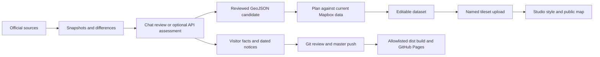

# Cville Trails

A map for the moment you need to know which way to turn, plus a repeatable maintenance system for the curated Charlottesville / Albemarle trail network. Mapbox Studio remains responsible for the map design. The site remains a small static application on GitHub Pages.

**Live site:** [cvilletrails.com](https://cvilletrails.com/) · **Deployment branch:** `master` · **Maintenance handoff:** November 2–3, 2026 (evening in Charlottesville; many receipts use the following UTC date).

## Start here when returning

Read the [session record and outstanding work](docs/session-2026-11-02.md), then follow the [maintenance workflow](docs/maintenance-workflow.md) for a new update. This README is the main command reference; the supporting guides explain the evidence, decisions and recovery procedures behind it.

| What you need | Guide |
| --- | --- |
| Repeat a source check, visual review and publication | [Maintenance workflow](docs/maintenance-workflow.md) |
| Find authoritative sources or add a different ingest pipeline | [Source research and ingestion](docs/source-research.md) |
| Understand datasets, tilesets, style versions, caching and recovery | [Mapbox and deployment operations](docs/mapbox-operations.md) |
| Add an infobox, change visitor facts or publish a notice | [Website content and interaction](docs/website-content.md) |
| See what runs automatically and what to automate next | [Automation roadmap](docs/automation-roadmap.md) |
| Recover the reasoning behind today's park choices and exceptions | [November session record](docs/session-2026-11-02.md) |

The current system has seven pipelines, 67 public catalog entries (65 specific networks plus the two City/County groupings), reviewed park ownership rules, and separate publication paths for map data and website content. The City dataset reached 225 features; Rivanna reached 72 while preserving all 65 pre-existing geometries. These are **dated publication checkpoints**, not permanent expected counts. Fetch a fresh inventory before the next geometry edit.

The latest County research found a public **1,902-feature trail service** with active, inactive, private, pending and future records. It informed infobox extents, but has **not** been imported as new map geometry. Biscuit Run's infobox explicitly warns that our map coverage is incomplete. See [the County ingestion work still required](docs/source-research.md#albemarle-county-newly-discovered-gis).

## The repeatable process

1. Inspect the working tree, saved state and last publication receipts. Restore the necessary evidence before resuming an old review.
2. Snapshot official sources and take a fresh Mapbox inventory. A first snapshot is a baseline; a failed fetch is an error, not “no change.”
3. Review changed source evidence in chat. Separate visitor information, temporary notices and route geometry.
4. Build a full candidate that preserves curation. Compare overlapping datasets by park before approving apparent additions.
5. Review the exact candidate on a map, export decisions, and generate a fresh plan against current remote data.
6. Apply the authorized plan, verify the dataset, wait for its tileset upload, and apply any separately reviewed style changes.
7. Verify the public map at more than one zoom. Distinguish cached tiles from failed publication.
8. Commit durable decisions and website content, push the intended website deployment, and archive local evidence needed for later recovery.

For an infobox-only update, steps 4–6 become a catalog edit and local website preview; Mapbox data publication is unnecessary. A model's assessment, a browser decision export, a plan hash and a completed publication receipt are different artifacts. The [workflow guide](docs/maintenance-workflow.md#artifacts-and-approval-boundaries) explains each one.



The scheduled checker currently stops at snapshots, candidates and review artifacts. It does not implement the whole diagram unattended.

## Product behavior

The map fills the screen. Location tracking, device heading where available, and compass/zoom controls stay accessible. As you focus on a configured trail network, the title changes to that network's name. Tap the title for details, or tap an individual trail. **Updates** filters reviewed notices by map area or trail system. Dates and expiry determine which notices appear. There is no invented sample news in the public feed.

Context titles use `context_mode` and optional `context_title` / `context_min_zoom` in `data/systems.json`. Small City parks use polygon-aware location checks; isolated destination parks use area envelopes; trail-mode networks also need a nearby rendered trail. County and city aggregate bounds do not activate titles. Zoom/viewport hysteresis reduces flickering, and zooming out restores Cville Trails. Details never open automatically. If the information panel is already open, its heading and content follow the title in the same 160 ms fade. The Updates panel remains a separate explicit view. Reduced-motion preferences are respected.

## Run locally

Python 3.12+ and Node 22+ are sufficient for local development, source checks and review. Live tileset publication additionally requires Tippecanoe and the AWS CLI (see below).

```sh
npm run build
python3 -m http.server 8000 --bind 127.0.0.1 --directory dist
```

Open http://localhost:8000. Serve `dist`, **not the repository root**, which may contain local credentials and review files. The build copies only public website files. Mapbox tiles require a network connection; this version does not provide offline maps or turn-by-turn routing.

Put credentials in the ignored `.env.local` file (see `.env.example`). The Python CLI loads it without sourcing it as shell code. The website uses only its existing public Mapbox display token. Secret tokens never belong in HTML, JavaScript, Git, or GitHub Pages artifacts.

## Repository layout

| Path | Purpose |
| --- | --- |
| `index.html`, `assets/` | Map, mobile panels, geolocation, trail details, notices |
| `data/systems.json` | Public trail-system descriptions, bounds, official links, source-layer associations |
| `data/updates.json` | Reviewed, dated public notices |
| `pipelines/<name>/` | Sources, ingest adapter, durable curation overrides, review instructions |
| `maintenance/` | Shared fetching, normalization, review, reconciliation, publishing, build tools |
| `config/mapbox.json` | Existing dataset → tileset → source-layer publishing targets |
| `config/style-contract.json` | Captured trail layers and curated color expressions from the live style |
| `.trail-state/` (ignored) | Raw snapshots, reviews, candidates, Mapbox backups, plans, publish journals |
| `docs/` | Operating guides, source research, dated session record and automation roadmap |

The public build excludes this documentation, the maintenance code and local evidence. Git history preserves tracked decisions, but **a fresh clone does not restore `.trail-state/`, exported browser decisions, or a Studio backup**. Preserve the evidence bundles described in the [archive checklist](docs/maintenance-workflow.md#archive-a-completed-or-paused-update).

## Check sources and review here in Codex

```sh
python3 -m maintenance check
# Or run just one pipeline/source:
python3 -m maintenance check --pipeline city --source city-gis
```

The default makes **no OpenAI API calls**. Each pipeline owns its registered authoritative URLs. The checker uses conditional requests where supported, saves content-addressed snapshots, and records changed or first-seen sources in `.trail-state/reviews/`. HTML is compared after stripping scripts/styles and normalizing text; links remain visible so changed map links can be noticed. PDFs are compared as files. Sources are not crawled recursively: register linked maps/notices explicitly. A first snapshot is a baseline, not evidence that something just changed.

For a review, ask Codex to inspect `.trail-state/report.json`, the relevant review JSON, its before/after snapshot files, and that pipeline's `review.txt`. The same packet is available explicitly:

```sh
python3 -m maintenance review-packet .trail-state/reviews/PIPELINE/REVIEW.json
# Save the chat's assessment as JSON matching the packet's result_schema, then:
python3 -m maintenance record-review .trail-state/reviews/PIPELINE/REVIEW.json .trail-state/assessment.json --reviewer Codex
```

An assessment contains `summary`, `map_change`, `uncertainties`, and proposed `notices`. Source content is evidence rather than executable instructions. A model can interpret a map legend or notice, but must not manufacture trail coordinates, dates, or access permissions. Inspect map PDFs visually as well as reading their text. Record conflicting sources and unknown dates instead of filling them in.

The optional future unattended mode is `check --llm`, with `OPENAI_API_KEY` and an optional `OPENAI_MODEL` (default `gpt-4.1`). It uses the Responses API with structured output and PDF inputs. Its assessment uses the same review artifact format. Failed API reviews remain retryable without another source change. API reviews also cannot publish.

Fetch errors are reported and make the command exit nonzero; they do not overwrite the last good snapshot or imply “no changes.” Some park websites reject automated requests. Those require an alternate authoritative endpoint or a review in the browser. The November 2026 first run successfully fetched City and RTF sources; Monticello and Albemarle web pages returned HTTP 403 from this environment.

## Per-pipeline ingestion

Each folder contains:

- `pipeline.json`: source IDs/URLs/formats, system IDs, and field mappings.
- `ingest.py`: `transform(collection, config, source_id)`, free to implement source-specific logic.
- `overrides.json`: durable manual decisions, keyed by upstream feature ID.
- `review.txt`: source-specific interpretation and review rules.

Adapters emit WGS84 GeoJSON with stable feature IDs and normalized `name`, `color`, `system_id`, `source_id`, `source_feature_id`, and `source_url` properties. Legacy properties are retained so the existing Studio expressions keep working. The normalized `color` is the official source's named color or null, not an invented display color; the Studio palette remains in the style. Missing IDs, duplicate IDs, invalid coordinates, and orphaned overrides stop ingestion.

The City pipeline fetches its official ArcGIS layer using explicit object-ID batches and checks completeness. It includes only records marked `Existing`; proposed/unknown-status and empty-geometry records are listed in its ingest report. Albemarle, Monticello and Rivanna monitor official documents and can normalize reviewed GeoJSON; their generic adapters do not automatically interpret each source. `visitor-info` intentionally rejects geometry ingestion. PDFs and RTF KML require their own review workflows. The newly discovered County GIS schema still needs a dedicated adapter and reviewed ID crosswalk.

City `connections.json` holds explicit reviewed endpoint joins. The Quarry Park / Avon Yard bridge junction uses one exact shared endpoint; the rule stops ingestion if either feature disappears or their endpoints drift more than one metre apart. This preserves the reviewed connection without silently stretching geometry to accommodate a changed source. Saved user review decisions and follow-up findings live in `pipelines/city/reviews/`.

```sh
python3 -m maintenance normalize monticello path/to/reviewed.geojson --source trail-guide --output .trail-state/candidates/monticello.geojson
```

Example override (not installed as a real feature):

```json
{
  "upstream-feature-id": {
    "feature_id": "existing-mapbox-feature-id",
    "properties": {"color": "red", "TrailName": "Red"}
  }
}
```

Overrides apply last, every run. Existing manually curated geometry is backed up before edits. A source that renumbers IDs or changes its schema needs a deliberate mapping migration; do not assume row numbers identify trails.

## Reconcile and publish map data

Mapbox read access needs `datasets:list`, `datasets:read`, plus read access to the style/tilesets. Writing additionally needs `datasets:write`, `uploads:write`, and `uploads:read`. Keep this token in `.env.local`, never in the public site.

```sh
# Read-only inventory and full backups of existing datasets and style:
python3 -m maintenance inventory

# Example: combine the city import with the current curated dataset.
python3 -m maintenance reconcile \
  .trail-state/mapbox/datasets/ckuppnp9h534y23pyswjd7n1a.geojson \
  .trail-state/candidates/city/city-gis.geojson \
  --legacy-id OBJECTID --output .trail-state/candidates/city/reconciled.geojson

# Read-only comparison against Mapbox at the time of review:
python3 -m maintenance plan city .trail-state/candidates/city/reconciled.geojson \
  --evidence 'reviewed source snapshot / review reference' \
  --output .trail-state/plans/city.json
```

Reconciliation matches unique upstream IDs, retains existing Mapbox feature IDs and curated name/color properties, and preserves unmatched old features. Conflicting properties and unmatched features are reported for review. It also preserves curated coordinates when topology is identical and every coordinate differs by at most 0.000001 degrees (roughly 0.11 m), avoiding changes caused only by projection roundoff. New fields and substantive geometry edits remain in the candidate. This is a conservative first-pass merge, not proof of correct correspondence: review additions, geometry, permissions, and possible overlap with other trail datasets before accepting.

The first City comparison produced 133 additions, 10 substantive geometry edits, and retained 13 unmatched curated features. Nine reviewed geometry edits were published during the November 2 session, followed by park consolidation and ten selected additions. The original full import was never accepted wholesale. Receipts and the latest checkpoint are indexed in the [session record](docs/session-2026-11-02.md). Counts will change with upstream data. The existing City label layer uses the older `City_Trails` source layer while lines use `City_Trails_2021-10-13`; that label migration remains a separate follow-up.

A plan embeds the complete before/after datasets, evidence reference, target, ingest report, change lists, and an approval hash. For visual review:

```sh
python3 -m maintenance review-map .trail-state/plans/city.json
python3 -m http.server 8001 --bind 127.0.0.1 --directory .trail-state/review-city
```

Open http://localhost:8001. Start with **Geometry changes**, then inspect additions, retained unmatched trails, name conflicts, and existing attribute changes. Orange is the saved current geometry; blue is the proposal. The view selector can show either version alone, and other networks stay visible to help identify duplicates. Changes to existing easement/ownership fields are separated from new metadata. The background comes from the live style; the colored before/after overlays come from the saved plan.

Record **Accept proposal**, **Keep current for now**, or **Needs discussion**, with optional notes. Browser storage is scoped to the exact plan hash. **Export decisions** saves a JSON file, including unfinished notes. It does not publish or change Mapbox. To generate a candidate containing only accepted changes:

```sh
python3 -m maintenance review-candidate .trail-state/plans/city.json \
  /path/to/city-review-decisions.json --output .trail-state/candidates/city/accepted.geojson
python3 -m maintenance plan city .trail-state/candidates/city/accepted.geojson \
  --evidence 'visual review and exported decisions' --output .trail-state/plans/city-accepted.json
```

Unreviewed, deferred, and discussion items preserve their current features; unaccepted additions are left out. Exported decisions cannot be applied to a different plan. The fresh plan still checks for intervening Studio edits before application. After reviewing the exact plan you intend to publish:

```sh
# Updates the editable dataset only:
python3 -m maintenance apply .trail-state/plans/city-accepted.json --approve FULL_APPROVAL_HASH

# Alternatively, update the dataset AND process its existing live tileset:
python3 -m maintenance apply .trail-state/plans/city-accepted.json --approve FULL_APPROVAL_HASH --publish
```

Choose one apply command; a plan cannot be reused after application. `--publish` starts the Mapbox upload and polls processing status. Without it, use `resume-publish` after verifying the completed write journal, as described below. Existing IDs and source-layer names are retained; no new tileset is created and the style is not rewritten. The current style references 15 tilesets, so routine updates reuse those targets. That observed count is not a verified account quota. Consolidating several datasets into a new standardized tileset requires a separate reviewed identity/property mapping and style migration.

Publishing requires **Tippecanoe** and the **AWS CLI** on PATH (`TIPPECANOE` may specify an alternate executable). These are not needed for source checks, review, or website builds. The publisher builds MBTiles with the configured source-layer name, validates the archive, stages it using short-lived credentials from Mapbox, and replaces the existing tileset. It uses zooms 0–16 (the account’s Uploads API limit) with no line simplification or feature dropping; higher map zooms overzoom those tiles. AWS account credentials are not required. Direct dataset export is deliberately avoided: the first live test produced an internal layer called `original`, incompatible with the existing style. Supplying an explicit MBTiles layer fixes this and keeps the style unchanged.

The publisher verifies the target layer, validates geometry, checks the approval hash, and refuses a dataset changed since review. It saves a complete backup and a per-write journal, paces writes below the API limit, and verifies the resulting dataset before starting tileset processing. Mapbox feature edits are not transactional: avoid simultaneous Studio editing during application. A network failure can leave a partially edited dataset; inspect `.trail-state/publishes/`. Do not blindly retry an attempted plan. Create a new plan against the current remote state, using the saved backup as the candidate to restore it. If an upload is still processing, use `python3 -m maintenance upload-status UPLOAD_ID`; an upload timeout does not mean Mapbox cancelled it.

Dataset reads use unique cache keys because the first live test returned cached data despite `Cache-Control: no-cache`. That test also established that Mapbox truncates written coordinates toward zero to six decimal places. Verification accepts the exact proposal or that specific storage conversion for written features only; all properties, feature IDs, topology and untouched features must still match. The journal records the actual stored hash.

If all feature writes completed but publication stopped, use `python3 -m maintenance resume-publish PLAN_PATH --approve FULL_APPROVAL_HASH`. This checks the original plan, backup, complete write journal and current dataset before uploading, without rewriting features. An existing upload ID is polled instead of submitting another upload. If the upload POST's outcome is unknown, it stops for inspection of recent Mapbox uploads rather than risking a duplicate submission. Partial feature writes still require reconciliation.

For a completed or failed upload whose internal layer does not match the configured layer, `resume-publish ... --repair-layer` verifies the reviewed dataset again, records the prior upload, and builds a replacement with the explicit layer name. It refuses this repair while an upload is still processing or when the expected layer is already present. Successful publication requires both upload completion and a matching layer referenced by the current style.

Tileset publication changes the map used by the existing website after Mapbox cache propagation; it does not require a website deploy. Website code and notice changes use GitHub Pages separately.

## Compare overlapping datasets by park

`compare-overlaps` measures proposed additions and geometry edits against the editable datasets referenced by the saved live style. It distinguishes trail lines from label-only layers, uses UTM zone 17N distances in meters, and reports coverage at 1, 3, 10 and 20 meters. Nearby parallel trails can still match: these are screening results, not proof of public access or superior accuracy. Reverse coverage shows how much existing geometry a replacement could lose. The separate Shenandoah tileset and basemap roads are outside this editable-dataset comparison.

The optional analysis dependencies are pinned in `maintenance/requirements-geo.txt`. A repeatable review preparation looks like:

```sh
python3 -m maintenance inventory --output .trail-state/overlap-inventory
python3 -m maintenance fetch-arcgis https://gisweb.charlottesville.org/arcgis/rest/services/Public/OpenData_1_UpdateAll/MapServer/178 --output .trail-state/research/city-park-areas.geojson
uv run --with-requirements maintenance/requirements-geo.txt python -m maintenance compare-overlaps .trail-state/plans/city-remaining.json --inventory .trail-state/overlap-inventory --output .trail-state/assessments/city-overlaps.json
uv run --with-requirements maintenance/requirements-geo.txt python -m maintenance review-parks .trail-state/plans/city-remaining.json --inventory .trail-state/overlap-inventory --boundaries .trail-state/research/city-park-areas.geojson --overlaps .trail-state/assessments/city-overlaps.json
python3 -m http.server 8002 --bind 127.0.0.1 --directory .trail-state/review-parks
```

Use your current proposal path in place of `city-remaining.json`. The inventory must match that proposal's current baseline; changed Studio edits require a fresh proposal. The park review is separate from the feature review on port 8001, so it does not reset those decisions. Preserve the generated review bundle while reviewing it: rebuilding produces a new review hash and a separate browser decision history.

Choose a preferred geometry dataset per park and export `park-dataset-decisions.json`. A recommendation is not preselected. Park decisions express ownership preferences only; they do not apply or approve cross-dataset deletions. Consolidation still needs a reviewable migration that preserves names, official colors, route identity, access restrictions and cross-boundary geometry. Features outside named park boundaries remain individual corridor decisions. City park assignment requires at least half of a feature's length to fall inside an official park polygon; all displayed park geometry is clipped to that polygon.

The initial comparison and proposed winners are recorded in `pipelines/city/reviews/2026-11-02-park-overlaps.json`. The other pipelines' `reviews/2026-11-02-source-audit.json` files record source discoveries, download failures and remaining checks. Linked official PDFs and the RTF public map export now have separate monitors. The KML remains evidence for manual review until stable feature identities and route-only selection are established.

`config/park-ownership.json` records resolved source choices and exceptions. The **entire Rivanna dataset is protected** from park consolidation, including overlaps, and its trail lines render above the other networks. The separately reviewed RT refresh preserved all 65 original geometries and added seven road walks, bringing the dated checkpoint to 72 features. Protection applies to the entire current network, not a frozen count of 65. The November 2 decision record preserves the user's original export and subsequent clarification: Quarry uses Rivanna plus City **Quarry Old Road (`city:3710`)**, while retaining existing trails; McIntire keeps City and Rivanna.

Prepare the resolved choices without changing Mapbox:

```sh
uv run --with-requirements maintenance/requirements-geo.txt python -m maintenance prepare-consolidation .trail-state/plans/city-remaining.json --review .trail-state/review-parks/review.json --decisions .trail-state/decisions/park-user-review.json --inventory .trail-state/overlap-inventory --output .trail-state/consolidation/parks
python3 -m maintenance review-consolidation .trail-state/consolidation/parks/manifest.json --review .trail-state/review-parks/review.json --inventory .trail-state/overlap-inventory --output .trail-state/review-consolidation
python3 -m http.server 8003 --bind 127.0.0.1 --directory .trail-state/review-consolidation
```

Preparation verifies review, decision, dataset and style hashes. It retains geometry outside the chosen parks, existing properties, and the full protected network. New City geometry is limited to the resolved areas and named supplements. Conflicting park polygons require explicit boundary precedence: the current proposal gives Heyward priority in its small overlap with Ragged. Check those boundary joins in the current/proposed preview before publication; coordinates are not automatically snapped. The official Heyward PDF is monitored, but its geometry still needs comparison with the newer GIS trails.

Park rules can also specify `retain_features` exceptions by dataset and feature ID. These keep the complete original geometry and properties, fail if the feature is absent from the reviewed inventory, and appear in the preparation manifest. Heyward now uses an explicit `geometry_replacements` exception for the Strava saddle connector: the user supplied three northern junction points and excluded the descent toward Round Top. Those points are joined to existing endpoints within 5 m, with each adjustment recorded in the policy. The route beyond the third point keeps its original coordinates. Replacements are bound to a source feature hash, preserve properties, and cannot affect protected or retained features. The preview’s “Show Round Top saddle connector” button zooms to this correction.

The manifest lists each dataset change and any style retirement. An emptied display layer is retired by proposing hidden style layers while retaining its original dataset as an archive; do not upload an empty replacement. Here, that affects the four old GPS tracks in the dedicated Ragged dataset, which lie inside Heyward. The preview also provides **Pick coordinates**: click or tap to add numbered, draggable pins, then copy latitude/longitude pairs into the review conversation. Points persist locally in the browser and do not change trail geometry. Nonempty candidates can become ordinary `plan` proposals with the recorded decisions as evidence. Publishing rejects stale ownership policies and any attempt to modify protected Rivanna through park consolidation. Neither preparation nor the preview publishes changes. Browser validation: `node tests/consolidation-browser.mjs` with the preview server running.

After approval, publish each nonempty candidate using its exact plan hash and wait for every upload to complete. Then run `python3 -m maintenance retire-style-layers MANIFEST_PATH --approve MANIFEST_HASH`. This verifies the replacement publications and protected datasets, checks that the style proposal only hides the reviewed obsolete layers, archives the untouched retired dataset, and backs up both live and draft styles. It applies the same visibility changes to the live style and Studio draft while preserving unrelated draft edits. The [Styles API](https://docs.mapbox.com/api/maps/styles/) treats those as separate versions, so updating only the live version would leave the obsolete layers enabled in Studio. Retirement has a durable write journal and refuses blind replay after an attempted update; inspect the saved responses and remote state if interrupted.

## Review the next round after publication

The original City review can retain its plan hash and browser notes while a separate resolution context accounts for published park choices. The context checks the approval, publication receipt, policy and current inventory hashes. Published additions and overlapping exclusions are hidden from the default queue; partial lines with unresolved boundary or coverage differences remain visible. Whole-proposal acceptance is blocked for features governed by the park decision, including lines whose approved portion was clipped. Exported historical decisions remain available without being applied again.

```sh
uv run --with-requirements maintenance/requirements-geo.txt python -m maintenance review-resolution-context .trail-state/plans/city-remaining.json --consolidation-audit pipelines/city/reviews/2026-11-02-park-decisions.json --park-review .trail-state/review-parks/review.json --current-inventory .trail-state/next-round-inventory --output .trail-state/review-city-resolution.json
python3 -m maintenance review-map .trail-state/plans/city-remaining.json --resolution-context .trail-state/review-city-resolution.json
python3 -m maintenance review-candidate .trail-state/plans/city-remaining.json EXPORTED_DECISIONS.json --resolution-context .trail-state/review-city-resolution.json --output .trail-state/candidates/city-next-reviewed.geojson
```

Use the current published inventory, not the pre-consolidation snapshot. A context-bound export requires its matching context. Candidate generation starts from the verified current City dataset and applies only reviewed changes; it does not restore the old baseline. A new ordinary Mapbox plan must still verify the live dataset before anything can be published.

After later addition batches are published, pass `--published-additions AUDIT_PATH` to `review-resolution-context` for each batch, in publication order, and supply an inventory containing the latest City dataset. It verifies the approved plans, completed write receipts, unchanged existing features, and continuous before/after hashes. Newly published additions and explicit “keep existing” choices then resolve in the original review without changing its plan hash or browser-note storage. Published plans are archived under `.trail-state/published-plans/` so later preparation does not overwrite the evidence.

The next-area review is separate from the original park-source review. It asks whether to include each remaining City addition, retain the existing map, or discuss an exception. It does not replace another dataset or delete Rivanna. Its export has a different review kind and is not a park-consolidation approval.

```sh
uv run --with-requirements maintenance/requirements-geo.txt python -m maintenance review-next-areas .trail-state/plans/city-next-areas.json --inventory .trail-state/next-round-inventory --boundaries .trail-state/research/city-park-areas.geojson --overlaps .trail-state/next-area-analysis/overlaps.json --assessment pipelines/city/reviews/2026-11-03-next-areas.json --output .trail-state/review-next-areas
python3 -m http.server 8004 --bind 127.0.0.1 --directory .trail-state/review-next-areas
```

Import an exported addition review with `remaining-addition-candidate`. It validates the report/plan hashes and exact feature IDs, copies the reviewed baseline unchanged, and adds only explicit `include` choices. `keep-existing`, `discuss`, and unanswered rows add nothing. The candidate's audit retains all decisions and notes. Generate an ordinary fresh Mapbox plan afterward to detect any intervening Studio edits; this command does not publish.

```sh
python3 -m maintenance remaining-addition-candidate .trail-state/plans/city-next-areas.json remaining-addition-decisions.json --review .trail-state/review-next-areas/review.json --output .trail-state/candidates/city-remaining-selected.geojson
python3 -m maintenance plan city .trail-state/candidates/city-remaining-selected.geojson --evidence pipelines/city/reviews/2026-11-03-remaining-decisions.json --output .trail-state/plans/city-remaining-selected.json
```

Rivanna has a separate read-only official-source comparison. It retains all current features, excludes event-only KML layers and reference markers from route comparisons, and reports closures/detours as source flags requiring verification. Name/folder and geometry keys are snapshot identities, not dependable upstream feature IDs; a crosswalk needs review before any future import.

```sh
uv run --with-requirements maintenance/requirements-geo.txt python -m maintenance.rivanna_compare --kml .trail-state/rivanna-refresh/official.kml --current .trail-state/rivanna-refresh/current.geojson --sources .trail-state/rivanna-refresh/sources.json --inventory .trail-state/next-round-inventory --output .trail-state/review-rivanna
python3 -m http.server 8005 --bind 127.0.0.1 --directory .trail-state/review-rivanna
```

These commands prepare review artifacts only. Source wording such as “Existing,” “new,” or “closed” is evidence to investigate, not an automatic access determination or website notice.

After the Rivanna source review, interpret its notes into an explicit action manifest (see `pipelines/rivanna/reviews/2026-11-03-decisions.json`). The candidate builder verifies the report, export, baseline, source geometry and existing feature identities. It preserves every existing geometry and curated name, uses assigned semantic IDs for new road walks, and combines overlapping closure references into a single status change. Snapshot keys remain evidence references, not permanent feature IDs. A future source change requires a new reviewed manifest; notes are never treated as executable instructions.

```sh
python3 -m maintenance.rivanna_candidate \
  --current .trail-state/rivanna-refresh/current.geojson \
  --review .trail-state/review-rivanna/report.json \
  --decisions /path/to/rivanna-source-review.json \
  --interpretation pipelines/rivanna/reviews/2026-11-03-decisions.json \
  --style .trail-state/post-additions-inventory/style.json \
  --output .trail-state/review-rivanna-candidate
python3 -m http.server 8006 --bind 127.0.0.1 --directory .trail-state/review-rivanna-candidate
```

This separate preview leaves the original source review and browser notes intact. It uses the proposed production layers: closed routes are red and labeled temporarily closed, while active routes retain their existing colors and draw order. `candidate.geojson`, `style-proposal.json`, and `manifest.json` are local preparation artifacts; this command makes no Mapbox writes. Dataset publication and the corresponding reviewed live/draft style changes must be coordinated before calling a closure visible on the public map.

After approval of that exact preview, create a normal Rivanna dataset plan and publish it with `maintenance apply --publish`. Then publish its matching closure style:

```sh
python3 -m maintenance.rivanna_publish .trail-state/plans/rivanna-reviewed.json \
  .trail-state/review-rivanna-candidate --approve EXACT_PROPOSAL_HASH
```

The style publisher requires the completed dataset receipt and matching live data, verifies the reviewed style diff, backs up both style versions, and changes only the three Rivanna display layers. It preserves unrelated Studio draft edits. An interrupted or previously attempted style publication requires inspecting its journal rather than blindly replaying it. `node tests/rivanna-publication-browser.mjs` checks the public style and tiles; `--fresh` separately checks fresh vector tiles and the unoptimized public style URL to distinguish CDN propagation from a failed publication. Neither check replaces remote data with local candidate geometry.

These historical browser checks require the corresponding local plans and preview files. They are not general checks for an arbitrary future release. The [Mapbox operations guide](docs/mapbox-operations.md#diagnose-old-data-at-one-zoom-and-new-data-at-another) records the later multi-zoom investigation: ordinary zoom-10 requests were stale while 12/14/16 were current, and fresh zoom-10/11 tile requests returned current data without changing the public style. Observed composite-tile headers allowed two hours of server caching and twelve hours of browser caching. Upload completion does not certify every cache has expired.

## Extract trails from an official GeoPDF

[Fortune’s Cove](pipelines/fortunes-cove/README.md) is the first repeatable PDF-vector ingest: seven georeferenced trail segments, official yellow/white colors, and an independent entrance-pin alignment check. Its dedicated pipeline monitors the TNC map and visitor page; extraction is bound to the reviewed PDF hash and requires review when that source changes. It reuses the supplemental tileset and preserves all other features. The guide includes extraction, preview, publication and future-update commands.

## Virginia State Parks

The statewide sanity-check preview is available at `http://localhost:8009/` while its local server runs: 492 proposed additions across 39 parks, with one batch decision and optional exclusions. See the [repeatable batch workflow](pipelines/virginia-state-parks/README.md#statewide-sanity-check). The user accepted the complete batch; its publication adds 492 trails and 39 basic park info panels. Held records remain excluded.

The [state-parks pipeline](pipelines/virginia-state-parks/README.md) uses DCR’s official statewide GIS service rather than tracing each park PDF. Its first snapshot contains 631 records across 43 named parks plus one unassigned record. Lake Anna’s 14 reviewed trails were the first import. The accepted statewide batch brings DCR coverage to 506 trails across 40 parks, reusing the supplemental Mapbox target. Three named areas have no accepted records: Culpeper Battlefields, Hayfields and Mayo River. The older queue remains at `http://localhost:8008/`; the accepted combined preview is at `http://localhost:8009/`. Proposed/reroute, closed, staff-only and ambiguous records are held. The guide explains stable IDs, official colors, source attribution and adding the next reviewed park.

## Publish trail notices

Review each proposed notice's source, affected systems, wording, and dates. Narrow `system_ids` in the review record if its pipeline covers several systems. Missing end dates require an explicit review expiry; expiry means “stop displaying this notice,” not “the trail reopened.” Closures need rechecking before expiry.

```sh
python3 -m maintenance approve-notice .trail-state/reviews/PIPELINE/REVIEW.json \
  --index 0 --reviewer YOUR_NAME \
  --starts 2026-11-02T00:00:00Z --expires 2026-11-09T00:00:00Z
```

This writes the local `data/updates.json` feed, ready for review in Git. It does not deploy. Notices are rendered as text, linked to their official source, and filtered by date and trail-system bounds. The first version uses system-level map relevance rather than distance from an individual trail segment. GPS is used locally; the report link includes coordinates in an email draft only after the user has enabled location tracking.

## Trail-system information

`data/systems.json` contains the location-aware infoboxes, concise visitor facts, official links, review dates, and a source ID for each fact. Small City parks use simplified official park polygons so shared trail layers resolve to the local park. Other networks use their curated trail extents and nearby rendered trails. These interface boundaries do not establish property access.

The `visitor-info` pipeline monitors official hours, dog rules, trail uses and admission pages. Each source identifies its affected systems; it supplies review evidence, never trail geometry or automatic publication. Run `python3 -m maintenance check --pipeline visitor-info` for snapshots and review artifacts. The November 2026 catalog audit is in `pipelines/visitor-info/reviews/2026-11-03-catalog.json`. Its first fetch established 20 source baselines; UVA Hereford's page returned HTTP 403 and requires browser review. Unverified rules are omitted, and the conflicting Washington Park closing times are explicitly noted.

With the built site served on port 8000, `node tests/system-info-browser.mjs` checks the 13 added contexts, official links, visitor facts, shared-layer selection and mobile layout. `node tests/context-panel-browser.mjs` checks synchronized title/panel fades.

The regional-network expansion adds Preddy Creek, Walnut Creek, Mint Springs, Byrom, Chris Greene Lake, Totier Creek and Biscuit Run, prioritizing standalone destinations. These networks use context envelopes around existing curated trails, active public County trails and available park geometry, so a view across a lake or between trails retains the park title. Biscuit Run's panel explicitly notes incomplete map coverage and links to the current official guide. Mint Springs includes the dam-work access notice without promising a reopening date.

`pipelines/visitor-info/reviews/2026-11-03-regional-networks.json` records official links, source-fetch results, extent evidence, the regional coverage audit and follow-up priorities. It also documents the newly found County Park Trails public GIS service: a complete 1,902-feature snapshot includes historical, private and planned routes, so it requires filtering and review before any map refresh. Only context bounds were derived from it; no Mapbox trail geometry was changed. Browser check: `node tests/system-info-browser.mjs pipelines/visitor-info/reviews/2026-11-03-regional-networks.json`.

## Automation and deployment

- **Validate:** tests and an allowlisted website build on pushes and pull requests. Uploads a website preview artifact.
- **Check authoritative trail sources:** daily snapshots and review artifacts, with no OpenAI API calls by default. Manual runs can opt into the API reviewer. The workflow has read-only repository permissions and no Mapbox editing token. It never publishes or messages anyone.
- **Deploy website:** pushes to `master` deploy the validated `dist/` artifact to GitHub Pages; manual dispatch is also available. Pages uses **GitHub Actions** as its source. Work on other branches does not replace the public website until merged to `master` or explicitly deployed.

The source-check workflow retains snapshots/reviews in an Actions cache and a 90-day artifact. Cache eviction creates a fresh baseline, not a deletion. Archive important evidence and accepted review decisions outside that retention window. An optional future API reviewer requires a repository `OPENAI_API_KEY` secret; local `.env.local` is never uploaded. There is no scheduled Mapbox writer in this first version.

## Verify

```sh
python3 -m unittest discover -s tests -p 'test_*.py'
npm test
npm run check
npm run build
```

Optional browser smoke test: install Playwright/Chromium in your development environment, then run `npm run test:browser`. It exercises the actual Mapbox page, mock device geolocation, automatic network titles, click-title details, updates, keyboard close, desktop layout, and exclusion of `.env.local` from the served build. With the City review page running on port 8001, `node tests/review-browser.mjs` checks overlays, filtering, decisions, notes, export, and persistence. `PLAYWRIGHT_MODULE` and `PLAYWRIGHT_CHROMIUM_EXECUTABLE` can select an existing installation. Real device heading and outdoor GPS accuracy still need a phone check.

## API references

[Mapbox legacy datasets](https://docs.mapbox.com/help/glossary/dataset/) remain accessible via the [Datasets API](https://docs.mapbox.com/api/maps/datasets/). The publisher uses the [Uploads API's staged-file upload](https://docs.mapbox.com/api/maps/uploads/); new tiling architecture should consider MTS separately. [Geolocation controls](https://docs.mapbox.com/mapbox-gl-js/api/markers/) document tracking and heading behavior. Optional API reviews use [OpenAI structured outputs](https://developers.openai.com/api/docs/guides/structured-outputs?api-mode=responses) and [PDF file inputs](https://developers.openai.com/api/docs/guides/file-inputs).
